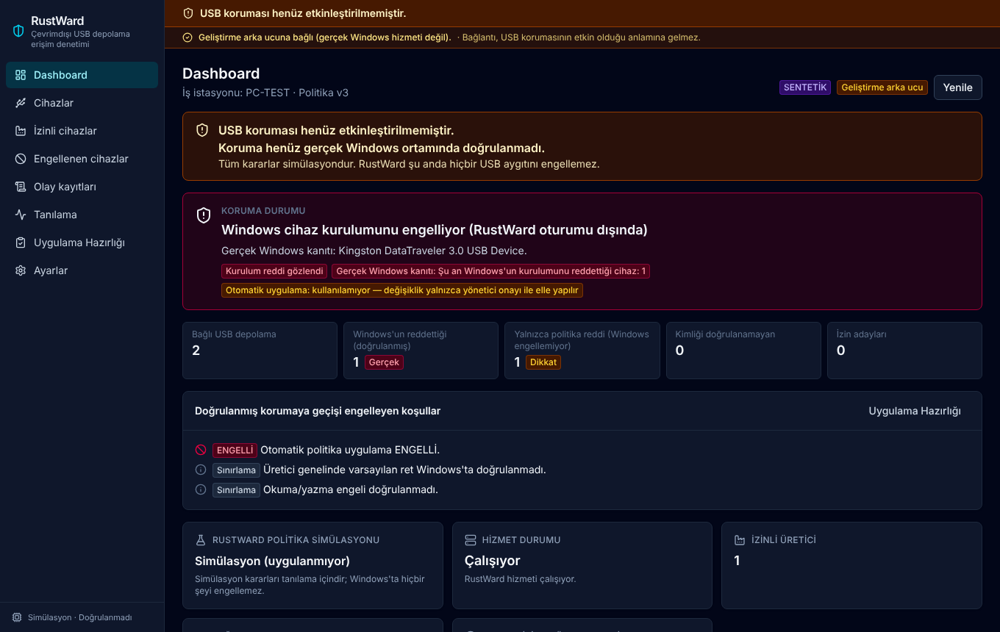
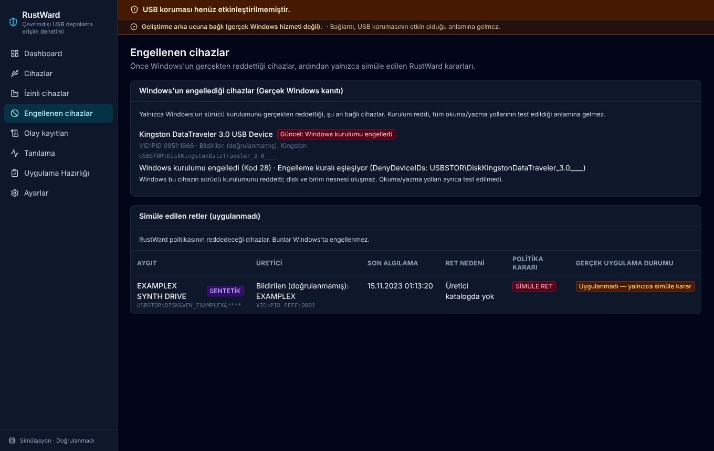
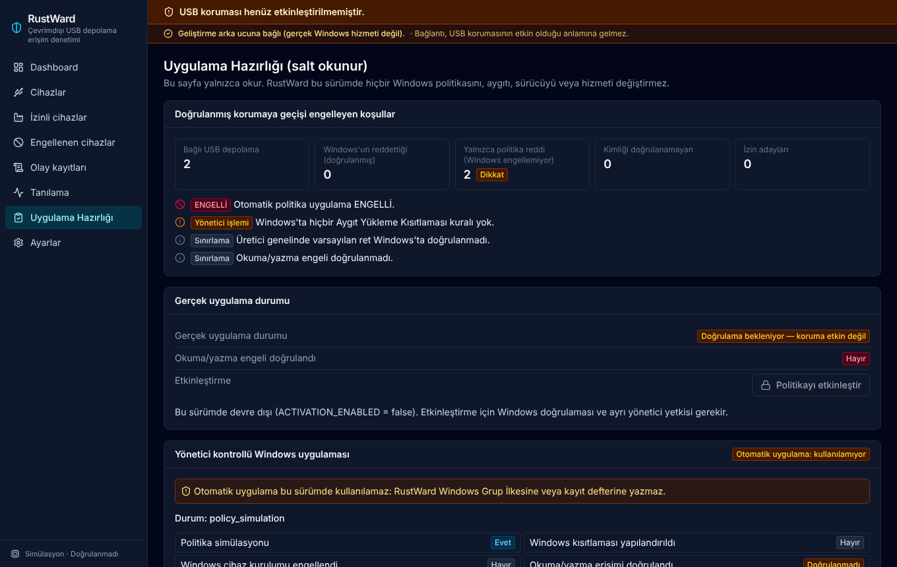
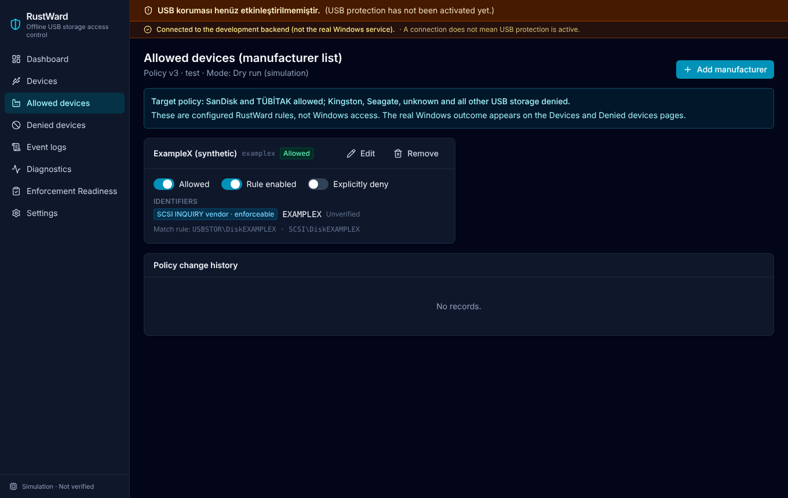

# RustWard

**Offline USB storage access-control assessment and administrator-guided
Windows enforcement for Windows 10/11 Pro.**

[Türkçe](README_TR.md) · Developer: **Yunus İNAN**

> **Status (Phase 6, November 2026): pre-release, VM-tested.**
>
> - RustWard **observes and verifies** real Windows USB state.
> - It **does not apply** Windows policy automatically. Automatic application
>   is **BLOCKED** by design.
> - Manufacturer identity is **self-reported** by the device and is never
>   authenticated.
> - An administrator applies Windows Group Policy changes. RustWard saves the
>   baseline, verifies the change exactly, observes the outcome, audits it and
>   verifies the rollback.
> - Do not deploy it to production workstations.

## Contents

- [Overview](#overview)
- [Features](#features)
- [Security model](#security-model)
- [Architecture](#architecture)
- [Technology stack](#technology-stack)
- [Supported Windows versions](#supported-windows-versions)
- [Installation](#installation)
- [VM testing guidance](#vm-testing-guidance)
- [Build](#build)
- [Testing](#testing)
- [Screenshots](#screenshots)
- [Known limitations](#known-limitations)
- [Roadmap](#roadmap)
- [Documentation](#documentation)

## Overview

RustWard targets standalone, air-gapped Windows workstations where USB mass
storage must follow a manufacturer policy:

| Manufacturer | Target policy |
|---|---|
| SanDisk | Allow |
| TÜBİTAK / BİLGEM / SIR II | Allow |
| Kingston, Seagate | Deny |
| Any other or unknown USB storage | Deny |
| Keyboards, mice, printers | Unaffected |

This is a **target policy, not a claim of achieved enforcement.** RustWard
evaluates every device against it. It also shows **separately** what Windows
really does with the device. The dashboard says "protected" only when Windows
is observed denying a device under a policy the administrator verified.

## Features

- **Real device inventory.** Read-only SetupAPI enumeration of USB storage,
  peripherals and internal disks. It records VID/PID, hardware IDs, SCSI
  INQUIRY vendor/product/revision, the parent chain, the connection state, the
  Windows problem code and the last real event. Inventory reads never block
  other requests.
- **Default-deny policy engine.**
  - Explicit allow and deny lists per manufacturer, with default deny for
    everything else.
  - Every in-scope device gets one policy category: `ALLOW_CANDIDATE`,
    `DENY_CANDIDATE`, `UNVERIFIED_IDENTITY`, `UNSUPPORTED_DEVICE` or
    `OUT_OF_SCOPE`.
  - It also gets one enforcement category: `WINDOWS_DENIAL_VERIFIED` or
    `ENFORCEMENT_NOT_ACTIVE`.
- **Identity grading.** The INQUIRY vendor and the USB VID are compared. The
  result is corroborated, single source, ambiguous, conflicting, generic or
  missing. An allow needs two agreeing sources, and nothing is ever marked
  authenticated.
- **Real Windows observation.**
  - It re-reads the Device Installation Restrictions and Removable Storage
    Access policies (read-only).
  - It correlates them with each device's problem code. The protection states
    are `unknown`, `inactive`, `configured_unverified`, `denial_observed` and
    `verified_active`.
- **Administrator-guided enforcement sessions:**
  - **Device deny.** One exact USB disk, by device ID, optionally retroactive.
    Verified in a VM.
  - **Default-deny profile.** Layered Device Installation Restrictions: prevent
    the DiskDrive class (never retroactive), allow the allowed manufacturers'
    IDs and the internal disks.

  Each session saves a baseline, shows a gpedit checklist in Turkish and
  English, verifies the change exactly, observes devices and verifies the
  rollback.
- **Real-time monitoring.** Device-change wake-up in the service, plus a UI
  watcher that refreshes only on real changes. There are no duplicate notices.
  "USB engellenmiştir. İşlem kayıt altına alınmıştır." appears **only** for a
  verified real Windows denial.
- **Audit.** SQLite (WAL), hash-chained and append-only, mirrored to the
  Windows Event Log. Denial episodes are deduplicated.
- **Readiness.** An ordered list of every condition that keeps the system out
  of a verified protection state.
- **Interface.** Complete Turkish localization (English available), with a dark
  theme.

## Security model

- **Privilege separation.**
  - The service runs as LocalSystem.
  - The desktop UI is unelevated and never opens the database.
  - A read-only status pipe serves any authenticated user.
  - An admin pipe accepts SYSTEM and Administrators with an elevated token;
    refusals are audited and rate-limited.
- **No Windows writes.** Registry access is `KEY_READ` only, and a test
  forbids write APIs in the policy reader. No device, driver or service
  configuration API is used.
- **Simulation is labelled.** Simulated decisions never trigger the
  real-block notice and never count as protection.
- **Honest identity.** USB descriptors and INQUIRY data can be cloned; RustWard
  says "reports SanDisk", not "is SanDisk".
- **Local administrators.** A local administrator can change Windows policy.
  RustWard detects and audits the change but cannot prevent it.

Details: [Phase 6 security review](docs/PHASE6-SECURITY-REVIEW.md) ·
[threat model](docs/THREAT-MODEL.md).

## Architecture

```
Tauri 2 app (React, TypeScript, Tailwind) ──named pipes──► rustward-service (LocalSystem)
                                                             ├─ rustward-app      requests, sessions, observation
                                                             ├─ rustward-core     catalog, policy, classification, decisions
                                                             ├─ rustward-enforcement  assessment, observer, plans, checklists
                                                             ├─ rustward-windows  read-only SetupAPI + registry, Event Log, SCM
                                                             ├─ rustward-ipc      contract, validation, authorization
                                                             └─ rustward-storage  SQLite, hash-chained audit
```

See [docs/PHASE6-ARCHITECTURE.md](docs/PHASE6-ARCHITECTURE.md).

## Technology stack

Rust (stable, 2024 edition), `windows-sys`, `windows-service`, SQLite
(`rusqlite`), Tauri 2, React 19, TypeScript, Tailwind CSS 4, Vitest and WiX
(MSI). Everything is bundled offline: no CDN and no runtime network access.

## Supported Windows versions

| Item | Requirement |
|---|---|
| OS | Windows 10 Pro/Enterprise/Education x64. Tested on 22H2 build 19045 (VM). Windows 11 builds; not acceptance-tested. |
| Layered evaluation (default-deny profile) | Windows 10 2004–22H2 build 19041.1151 or later, or Windows 11 |
| Runtime | WebView2 Runtime (bundled installer), VC++ runtime |
| Network | None |

## Installation

> Test it in a disposable virtual machine first.

1. Build the MSI (see [Build](#build)) and copy
   `dist\installer\RustWard_0.1.0_x64_tr-TR.msi` to the target. Check its
   SHA-256.
2. Install it as an administrator. The MSI installs the application, the
   `RustWard USB Depolama Denetimi` service and the Event Log source.
3. Start **RustWard**. Run it as administrator for policy edits and guided
   sessions.
4. To uninstall, use Apps & features. The audit database is kept unless it is
   removed deliberately.

RustWard changes no Windows security setting during installation.

## VM testing guidance

1. Use a dedicated Windows 10 Pro VM. Take a **named snapshot** before any
   experiment.
2. Pass USB sticks through to the VM (VMware: VM › Removable Devices).
   Use disposable sticks only.
3. Record the Windows version and the current policy state on the RustWard
   *Readiness* page.
4. Prepare a guided session. Apply the checklist **yourself** in `gpedit.msc`,
   then run `gpupdate /force` and **Uygulamayı doğrula**.
5. Check the outcome independently in Device Manager and Explorer.
   Keyboard and mouse must keep working.
6. Roll back: set the settings to *Not Configured*, run `gpupdate /force`,
   then **Geri almayı doğrula**. Revert to the snapshot if anything differs.
7. Never treat an installation denial as proof of read/write denial.

Never run policy experiments on a development host or a production
workstation.

## Build

On Windows, with Rust (MSVC), Visual Studio C++ tools, the Windows SDK,
Node.js and WebView2: double-click `BUILD-RUSTWARD.cmd`. It installs nothing
and needs no administrator rights.

| Output | Purpose |
|---|---|
| `dist\RustWard.exe` | Desktop application (talks to the service) |
| `dist\service\rustward-service.exe` | Windows service |
| `dist\service\rustward-inventory.exe` | Read-only inventory tool |
| `dist\installer\RustWard_0.1.0_x64_tr-TR.msi` | Complete installer (Turkish UI) |

Build logs are written to `build-logs\`, which is not committed.

## Testing

```bash
./scripts/verify-all.sh    # fmt, clippy (default + all features), Rust tests, Vitest,
                           # UI ↔ real-backend integration, cargo deny, offline-asset check
cd apps/rustward-desktop && npm ci && npm test
```

Optional checks:

- `RUSTWARD_WINDOWS_TARGET_CHECK=1` cross-checks the Windows target on Linux.
- Native Windows tests: `cargo test -p rustward-windows --test native_windows`
  (run on Windows only).

Test evidence is in [docs/TEST-RESULTS.md](docs/TEST-RESULTS.md) and
[docs/PHASE6-VM-TEST-REPORT.md](docs/PHASE6-VM-TEST-REPORT.md).

## Screenshots

Rendered from the automated-test fixtures (**synthetic data**, development
backend), so no real machine or device data is shown.

| Dashboard (Turkish) | Blocked devices |
|---|---|
|  |  |
| **Readiness** | **Allowed manufacturers (English)** |
|  |  |

## Known limitations

- Automatic Windows policy application is **BLOCKED**.
- Manufacturer identity is self-reported (cloneable). VID-only rules don't
  exist for USB disks.
- Install-time rules do not affect already-installed devices. The default-deny
  profile is never retroactive.
- Read/write denial is not verified by an installation denial. Removable
  Storage Access is class-wide and cannot allow one brand while denying
  another.
- TÜBİTAK SIR II identifiers are unknown, so its devices are denied.
- No genuine SanDisk device has been tested.
- Local administrators can change or remove Windows policy.

Full list: [docs/PHASE6-KNOWN-LIMITATIONS.md](docs/PHASE6-KNOWN-LIMITATIONS.md).

## Roadmap

1. VM acceptance of the default-deny profile and of Removable Storage Access
   on the current patch level.
2. Physical identification of TÜBİTAK SIR II, before and after unlock, on at
   least two units.
3. Validation on genuine SanDisk devices across several models.
4. Code signing of the service, application and MSI.
5. A decision on any automated application path. It needs a separate security
   review and is currently BLOCKED.

## Documentation

| Document | Content |
|---|---|
| [PHASE6-ARCHITECTURE](docs/PHASE6-ARCHITECTURE.md) | Components, data flow, protection states |
| [PHASE6-DEFAULT-DENY-POLICY](docs/PHASE6-DEFAULT-DENY-POLICY.md) | Policy model and categories |
| [PHASE6-MANUFACTURER-VALIDATION](docs/PHASE6-MANUFACTURER-VALIDATION.md) | Identity evidence and grades |
| [PHASE6-WINDOWS-ENFORCEMENT-FEASIBILITY](docs/PHASE6-WINDOWS-ENFORCEMENT-FEASIBILITY.md) | Feasibility matrix |
| [PHASE6-VM-TEST-REPORT](docs/PHASE6-VM-TEST-REPORT.md) | VM acceptance results |
| [PHASE6-SECURITY-REVIEW](docs/PHASE6-SECURITY-REVIEW.md) | Security review |
| [PHASE6-KNOWN-LIMITATIONS](docs/PHASE6-KNOWN-LIMITATIONS.md) | Limitations |
| [TEST-RESULTS](docs/TEST-RESULTS.md) | Test history |
| [OFFLINE-DEPLOYMENT](docs/OFFLINE-DEPLOYMENT.md) | Offline build and installation |

Earlier phase documents remain in [`docs/`](docs/).
