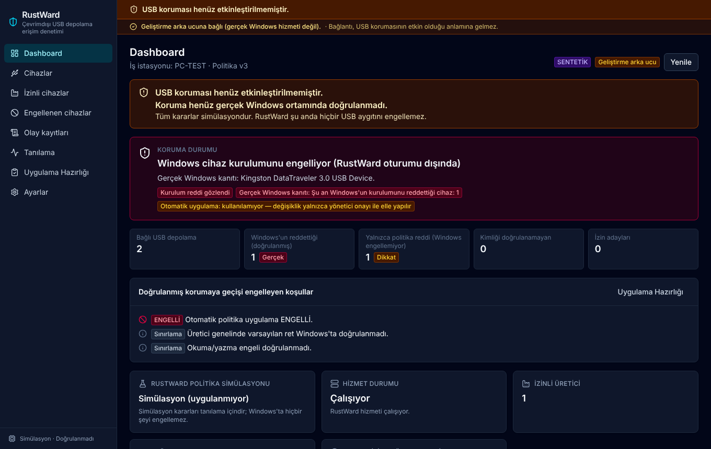
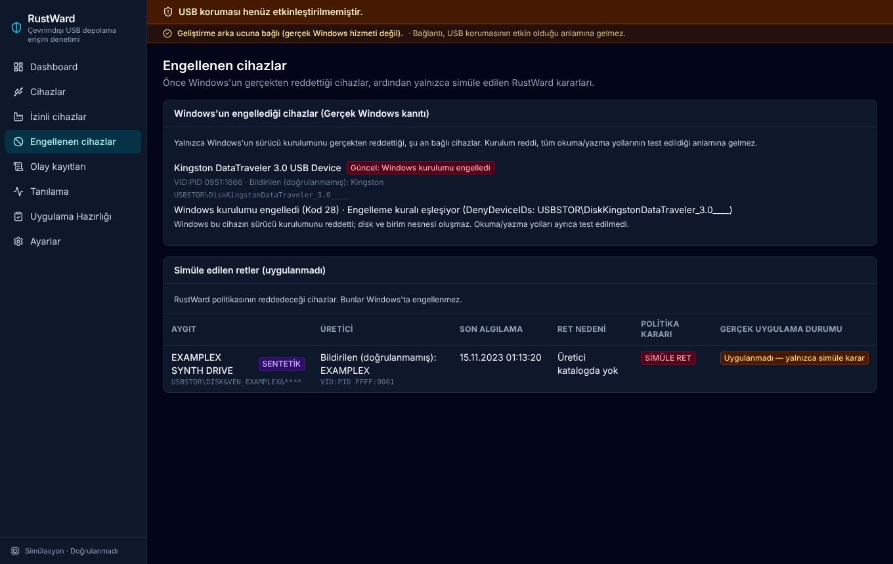
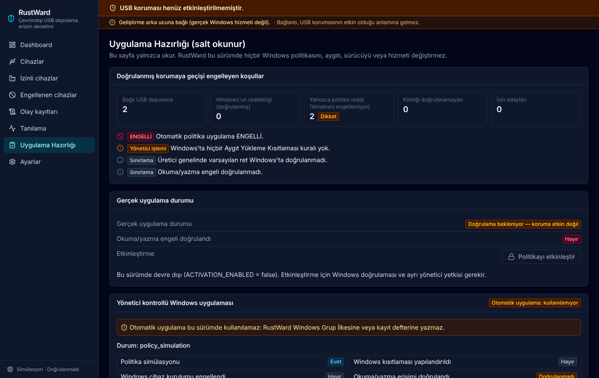

# RustWard

**Windows 10/11 Pro için çevrimdışı USB depolama erişim denetimi
değerlendirmesi ve yönetici onaylı Windows uygulaması.**

[English](README.md) · Geliştirici: **Yunus İNAN**

> **Durum (Faz 6, Kasım 2026): yayın öncesi, sanal makinede test edildi.**
>
> - RustWard gerçek Windows USB durumunu **gözler ve doğrular**.
> - Windows politikasını **otomatik olarak uygulamaz**. Otomatik uygulama
>   tasarım gereği **ENGELLİ**dir.
> - Üretici kimliği cihazın **kendi bildirimidir**; hiçbir zaman
>   kriptografik olarak doğrulanmaz.
> - Grup İlkesi değişikliğini yönetici yapar. RustWard önceki durumu kaydeder,
>   değişikliği birebir doğrular, sonucu gözler, denetim kaydına yazar ve geri
>   almayı doğrular.
> - Üretim iş istasyonlarına kurmayın.

## İçindekiler

- [Genel bakış](#genel-bakış)
- [Özellikler](#özellikler)
- [Güvenlik modeli](#güvenlik-modeli)
- [Mimari](#mimari)
- [Teknoloji yığını](#teknoloji-yığını)
- [Desteklenen Windows sürümleri](#desteklenen-windows-sürümleri)
- [Kurulum](#kurulum)
- [Sanal makinede test](#sanal-makinede-test)
- [Derleme](#derleme)
- [Testler](#testler)
- [Ekran görüntüleri](#ekran-görüntüleri)
- [Bilinen sınırlamalar](#bilinen-sınırlamalar)
- [Yol haritası](#yol-haritası)
- [Belgeler](#belgeler)

## Genel bakış

Hedef, USB depolamanın üreticiye göre denetlenmesi gereken bağımsız ve ağdan
yalıtılmış Windows iş istasyonlarıdır:

| Üretici | Hedef politika |
|---|---|
| SanDisk | İzin |
| TÜBİTAK / BİLGEM / SIR II | İzin |
| Kingston, Seagate | Ret |
| Diğer veya bilinmeyen tüm USB depolama | Ret |
| Klavye, fare, yazıcı | Etkilenmez |

Bu bir **hedef politikadır; elde edilmiş bir koruma iddiası değildir.**
RustWard her cihazı bu politikaya göre değerlendirir ve Windows'un o cihaza
gerçekte ne yaptığını **ayrıca** gösterir. Panel "korunuyor" der, ancak
yöneticinin doğruladığı bir politika altında Windows'un bir cihazı
gerçekten reddettiği gözlenirse.

## Özellikler

- **Gerçek cihaz envanteri.** Salt okunur SetupAPI ile USB depolama, çevre
  birimleri ve dahili diskler okunur. Kaydedilenler: VID/PID, donanım
  kimlikleri, SCSI INQUIRY üretici/ürün/sürüm, üst aygıt zinciri, bağlantı
  durumu, Windows sorun kodu ve son gerçek olay. Envanter okuması diğer
  istekleri bekletmez.
- **Varsayılan ret politika motoru.**
  - Üretici bazında açık izin ve açık ret listeleri vardır; geri kalan her şey
    reddedilir.
  - Kapsamdaki her cihaz bir politika kategorisi alır: `ALLOW_CANDIDATE`,
    `DENY_CANDIDATE`, `UNVERIFIED_IDENTITY`, `UNSUPPORTED_DEVICE` veya
    `OUT_OF_SCOPE`.
  - Ayrıca bir uygulama kategorisi alır: `WINDOWS_DENIAL_VERIFIED` veya
    `ENFORCEMENT_NOT_ACTIVE`.
- **Kimlik derecelendirmesi.** INQUIRY üretici adı ile USB VID karşılaştırılır.
  Sonuç uyumlu, tek kaynak, belirsiz, çelişkili, genel veya eksik olur. İzin
  için iki uyumlu kaynak gerekir ve hiçbir kimlik "doğrulanmış" sayılmaz.
- **Gerçek Windows gözlemi.**
  - Aygıt Yükleme Kısıtlamaları ve Çıkarılabilir Depolama Erişimi ilkeleri
    salt okunur olarak yeniden okunur.
  - Bunlar her cihazın sorun koduyla ilişkilendirilir. Koruma durumları:
    bilinmiyor, etkin değil, yapılandırılmış ama doğrulanmamış, ret
    gözlendi ve doğrulandı.
- **Yönetici onaylı uygulama oturumları:**
  - **Tek cihaz reddi.** Tek bir USB disk, aygıt kimliğiyle reddedilir;
    isteğe bağlı olarak geriye dönük. Sanal makinede doğrulandı.
  - **Varsayılan ret profili.** Katmanlı Aygıt Yükleme Kısıtlamaları: DiskDrive
    sınıfı engellenir (asla geriye dönük değil); izinli üreticilerin kimlikleri
    ve dahili diskler izinlidir.

  Her oturum önceki durumu kaydeder ve Türkçe/İngilizce bir gpedit kontrol
  listesi verir. Değişikliği birebir doğrular, cihazları gözler ve geri
  almayı doğrular.
- **Gerçek zamanlı izleme.** Hizmet aygıt değişikliğinde uyanır. Arayüz yalnızca
  gerçek değişiklikte yenilenir ve aynı bildirim iki kez gösterilmez.
  "USB engellenmiştir. İşlem kayıt altına alınmıştır." bildirimi **yalnızca**
  doğrulanmış gerçek bir Windows reddinde görünür.
- **Olay kayıtları.** SQLite (WAL), karma zincirli ve yalnızca eklemeli; Windows
  Olay Günlüğü'ne de yazılır. Ret dönemleri tekilleştirilir.
- **Uygulama hazırlığı.** Doğrulanmış korumaya geçişi engelleyen her koşul
  sırayla listelenir.
- **Arayüz.** Tam Türkçe arayüz (İngilizce de var), koyu tema.

## Güvenlik modeli

- **Ayrı yetkiler.**
  - Hizmet LocalSystem olarak çalışır.
  - Arayüz yetkisiz çalışır ve veritabanını açmaz.
  - Salt okunur durum kanalı her kimliği doğrulanmış kullanıcıya açıktır.
  - Yönetici kanalı yalnızca yükseltilmiş yetkili SYSTEM ve Yöneticiler
    içindir. Reddedilen istekler denetlenir ve hız sınırına tabidir.
- **Windows'a yazmaz.** Kayıt defteri yalnızca `KEY_READ` ile açılır; bir test
  ilke okuyucusunda yazma API'lerini yasaklar. Aygıt, sürücü veya hizmet
  yapılandırma API'si kullanılmaz.
- **Simülasyon etiketlidir.** Simülasyon kararları gerçek engel bildirimini
  tetiklemez ve koruma sayılmaz.
- **Dürüst kimlik.** USB tanımlayıcıları ve INQUIRY verileri kopyalanabilir.
  RustWard "SanDisk'tir" demez, "SanDisk bildiriyor" der.
- **Yerel yöneticiler.** Yerel yönetici Windows ilkesini değiştirebilir.
  RustWard değişikliği algılar ve kaydeder, ama engelleyemez.

## Mimari

```
Tauri 2 uygulaması ──adlandırılmış kanallar──► rustward-service (LocalSystem)
  ├─ rustward-app          istekler, oturumlar, gözlem
  ├─ rustward-core         katalog, politika, sınıflandırma, karar
  ├─ rustward-enforcement  değerlendirme, gözlemci, plan, kontrol listesi
  ├─ rustward-windows      salt okunur SetupAPI ve kayıt defteri, Olay Günlüğü
  ├─ rustward-ipc          sözleşme, doğrulama, yetkilendirme
  └─ rustward-storage      SQLite, karma zincirli denetim kaydı
```

Ayrıntı: [docs/PHASE6-ARCHITECTURE.md](docs/PHASE6-ARCHITECTURE.md).

## Teknoloji yığını

Rust, `windows-sys`, `windows-service`, SQLite, Tauri 2, React 19,
TypeScript, Tailwind CSS 4, Vitest ve WiX (MSI). Her şey çevrimdışı
paketlenir: CDN veya çalışma zamanı ağ erişimi yoktur.

## Desteklenen Windows sürümleri

| Öğe | Gereksinim |
|---|---|
| İşletim sistemi | Windows 10 Pro/Enterprise/Education x64. 22H2 derleme 19045'te (sanal makine) test edildi. Windows 11'de derlenir, kabul testi yapılmadı. |
| Katmanlı değerlendirme (varsayılan ret profili) | Windows 10 2004–22H2 derleme 19041.1151 ve sonrası veya Windows 11 |
| Çalışma ortamı | WebView2 (kurulumla gelir), VC++ çalışma zamanı |
| Ağ | Gerekmez |

## Kurulum

> Önce silinebilir bir sanal makinede deneyin.

1. MSI'ı derleyin ve `dist\installer\RustWard_0.1.0_x64_tr-TR.msi` dosyasını
   hedefe kopyalayın. SHA-256 değerini kontrol edin.
2. Yönetici olarak kurun. Kurulum uygulamayı, `RustWard USB Depolama Denetimi`
   hizmetini ve Olay Günlüğü kaynağını ekler.
3. RustWard'ı başlatın. Politika düzenleme ve yönetici oturumları için
   "Yönetici olarak çalıştır" kullanın.
4. Kaldırmak için Uygulamalar ve özellikler'i kullanın.

Kurulum hiçbir Windows güvenlik ayarını değiştirmez.

## Sanal makinede test

1. Ayrı bir Windows 10 Pro sanal makine kullanın. Her denemeden önce
   **adlandırılmış anlık görüntü** alın.
2. USB bellekleri sanal makineye bağlayın (VMware: VM › Removable Devices).
   Yalnızca silinebilir bellekler kullanın.
3. RustWard *Uygulama Hazırlığı* sayfasında Windows sürümünü ve mevcut ilke
   durumunu kaydedin.
4. Yönetici oturumunu hazırlayın. Kontrol listesini `gpedit.msc` içinde
   **kendiniz** uygulayın, sonra `gpupdate /force` çalıştırıp
   **Uygulamayı doğrula**'ya basın.
5. Sonucu Aygıt Yöneticisi ve Dosya Gezgini'nde ayrıca kontrol edin.
   Klavye ve fare çalışmaya devam etmelidir.
6. Geri alma: ayarları "Yapılandırılmadı" yapın, `gpupdate /force`
   çalıştırın, sonra **Geri almayı doğrula**'ya basın. Fark varsa anlık
   görüntüye dönün.
7. Kurulum reddini okuma/yazma engelinin kanıtı saymayın.

Geliştirme bilgisayarında veya üretim iş istasyonunda ilke denemesi yapmayın.

## Derleme

Windows'ta (Rust MSVC, Visual Studio C++ araçları, Windows SDK, Node.js,
WebView2) `BUILD-RUSTWARD.cmd` dosyasına çift tıklayın. Hiçbir şey kurmaz ve
yönetici yetkisi gerektirmez. Çıktılar `dist\` klasörüne, günlükler
`build-logs\` klasörüne yazılır.

## Testler

```bash
./scripts/verify-all.sh
cd apps/rustward-desktop && npm ci && npm test
```

Test kanıtları: [docs/TEST-RESULTS.md](docs/TEST-RESULTS.md),
[docs/PHASE6-VM-TEST-REPORT.md](docs/PHASE6-VM-TEST-REPORT.md).

## Ekran görüntüleri

Görüntüler otomatik test verileriyle (**sentetik veri**, geliştirme arka ucu)
oluşturuldu; gerçek makine veya cihaz bilgisi içermez.

| Dashboard | Engellenen cihazlar |
|---|---|
|  |  |
| **Uygulama Hazırlığı** | |
|  | |

## Bilinen sınırlamalar

- Otomatik Windows ilkesi uygulama **ENGELLİ**dir.
- Üretici kimliği cihazın kendi bildirimidir ve kopyalanabilir.
- Kurulum zamanı kuralları zaten kurulu cihazları etkilemez. Varsayılan ret
  profili asla geriye dönük değildir.
- Kurulum reddi okuma/yazma engelini kanıtlamaz. Çıkarılabilir Depolama
  Erişimi sınıf genelidir; bir markaya izin verip diğerini reddedemez.
- TÜBİTAK SIR II kimlikleri bilinmiyor, bu yüzden bu cihazlar reddedilir.
- Gerçek bir SanDisk cihazı test edilmedi.
- Yerel yöneticiler Windows ilkesini değiştirebilir.

Tam liste: [docs/PHASE6-KNOWN-LIMITATIONS.md](docs/PHASE6-KNOWN-LIMITATIONS.md).

## Yol haritası

1. Varsayılan ret profili ve güncel yama seviyesinde Çıkarılabilir Depolama
   Erişimi için sanal makine kabul testi.
2. TÜBİTAK SIR II'nin fiziksel tanımlanması: kilit açılmadan önce ve sonra, en
   az iki cihazda.
3. Birkaç modelde gerçek SanDisk cihazlarıyla doğrulama.
4. Hizmet, uygulama ve MSI için kod imzalama.
5. Otomatik uygulama yolu için karar. Bu ayrı bir güvenlik incelemesi
   gerektirir ve şu an ENGELLİ'dir.

## Belgeler

Faz 6 belgeleri `docs/PHASE6-*.md` dosyalarındadır (İngilizce). Önceki fazların
belgeleri [`docs/`](docs/) klasöründedir.
