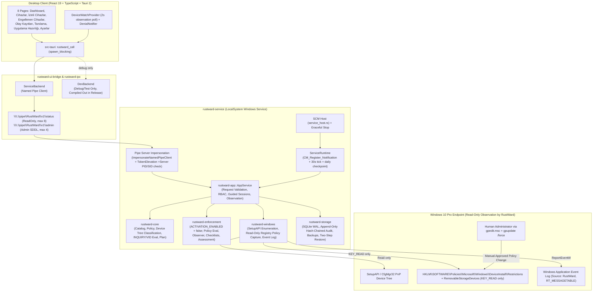

# ARGON Phase 0 — Complete Repository Audit & Baseline Report

**Date:** 2026-11-08  
**Workspace:** `<workspace>` (isolated copy; `<baseline-workspace>` untouched and treated strictly as read-only)  
**Active Branch:** `experiment/argon4-vm-enforcement` (branched cleanly from `9ba61b58f4809715e5a053a544f31e911fd51649`)

---

## 1. Pre-Modification Baseline State

### 1.1 Git & Workspace State

| Item | Recorded Value |
|---|---|
| Original branch at handoff | `feature/phase6-default-deny` |
| Handoff commit SHA | `9ba61b58f4809715e5a053a544f31e911fd51649` (`9ba61b5`) |
| Isolated development branch | `experiment/argon4-vm-enforcement` (`main` at `be4fac6` and `feature/phase6-default-deny` at `9ba61b5` untouched) |
| Working-tree status | Clean (`0` modified, `0` untracked tracked-scope files; `dist/`, `target/`, `build-logs/` gitignored) |
| Local branches | `experiment/argon4-vm-enforcement` (`9ba61b5`), `feature/phase6-default-deny` (`9ba61b5`), `main` (`be4fac6`) |
| Remote-tracking refs | `remotes/bundle/p5` (`8dfecd1`), `p5b` (`77b7794`), `p5c` (`be4fac6`), `p6a` (`c9b6c0e`), `p6b` (`9ba61b5`); no network remote configured (`git remote -v` empty) |

### 1.2 Host Operating System & Service Isolation Check

| Check | Result |
|---|---|
| Host OS | Windows 11 Pro 25H2 (64-bit, build `26200.8037`) — untouched |
| Installed `RustWard*` Windows services on host | **None** (`0` services matching `*rustward*`) |
| Running `rustward*` processes on host | **None** |
| Host Device Installation Restrictions modified | **Never** (strictly prohibited) |

### 1.3 Build Prerequisites Verified on Build Machine

| Prerequisite | Installed Version / Path |
|---|---|
| Rust / Cargo (`x86_64-pc-windows-msvc`) | `rustc 1.92.0` / `cargo 1.92.0` (`%USERPROFILE%\.cargo\bin`) |
| Visual Studio C++ Build Tools (MSVC x64) | VS 2022 BuildTools (`link.exe`, `dumpbin.exe` Hostx64\x64) |
| Windows 10/11 SDK (`rc.exe`, `windows.h`) | Installed under `C:\Program Files (x86)\Windows Kits\10` |
| WiX Toolset v3 | `3.14` (`%LOCALAPPDATA%\tauri\WixTools314\candle.exe`, `light.exe`) |
| Node.js / npm | `v24.17.0` / `11.13.0` |
| WebView2 Runtime | `147.0.3912.60` / EdgeUpdate client present |
| VMware Workstation | `17.6.4` (`vmrun.exe`) |

### 1.4 Pre-Existing Native Binaries & MSI Packages in `dist\` (from `c9b6c0e`)

| Artifact | Size (bytes) | SHA-256 |
|---|---:|---|
| `dist\RustWard.exe` | 4,156,416 | `a40480d4381bb0cae42b714b0c2866edc378713e14c5c58967f2d002e821e775` |
| `dist\RustWard-Onizleme.exe` | 21,894,144 | `8aa6e90a92e66dc691777a0206f70ad6306af9a37fdbef09cc9a2317fdbef0` *(full: `8aa6e90a92e66dc691777a0206f70ad6306af9a37fdbef09cc9a23c38d9cd06e`)* |
| `dist\service\rustward-service.exe` | 3,426,304 | `dcc6025adf335e10dd89406c3fbfcc052552ed01934d458b034f2fde5186cc48` |
| `dist\service\rustward-inventory.exe` | 783,872 | `f7e122d10e6a8bb6e29603eee8921bb3f3677913e9b22998805299ec990fcfc8` |
| `dist\installer\RustWard_0.1.0_x64_tr-TR.msi` | 219,181,056 | `fd9e203c99f9fe4b909319496ed38cc7842f15b128d37fafc1b172143f2774b7` |
| `dist\installer\RustWard_0.1.0_x64_en-US.msi` | 218,984,448 | `276f31e268d9edf0c571a538a9fc4a477409b714fd42d9700ae3b231743755ed` |
| `dist\vm\rustward-test-7.iso` | 219,244,544 | `b0084de3a65dc474a47561b7e34434dc2ebaeaa92973d931381fc4704709918c` |

### 1.5 Pre-Modification Test Baseline on Native Windows

| Suite | Command | Baseline Result (`9ba61b5`) | Root Cause of Any Failure |
|---|---|---|---|
| Rust workspace (including 5 native Windows tests) | `cargo test --workspace --no-fail-fast` | **340 passed, 1 FAILED** | `rustward-app` `app_flows::enforcement_readiness_is_read_only_and_reports_inspection_and_assessment` assumed `LivePolicySource` fails (true on Linux, false on Windows where `RegOpenKeyExW(KEY_READ)` succeeds). |
| Tauri shell crate | `cargo test` (`src-tauri`) | **4 passed, 0 failed** | — |
| Frontend TypeScript | `npx tsc --noEmit` | **0 errors** | — |
| Frontend Vitest unit tests | `npm test -- --run` | **83 passed, 0 failed** (9 files) | Emits React duplicate-key warning on `"brand_not_enforceable: tubitak"`. |
| Frontend ↔ real Rust backend integration | `npx vitest -c vitest.integration.config.ts run` | **1 passed, 15 FAILED** | (1) `stdioBackend.ts` calls `rmSync` immediately after `child.kill()` without awaiting process exit (`EPERM` on open SQLite WAL handles on Windows). (2) `DevBackend` defaults to live host SetupAPI + live Windows registry on `cfg!(windows)` instead of deterministic test isolation. |

### 1.6 VMware Guest & Snapshot Baseline (Read-Only Inspection)

- **Running VMs:** `0` (`vmrun list` -> `Total running VMs: 0`).
- **Authorized Test VM:** `<test-vm>.vmx` — Guest OS reported in `.vmx`: `Windows 10 Pro, 64-bit (Build 19045.6466)`, UEFI (`firmware = "efi"`), 2 vCPUs, 2048 MB RAM, NVMe boot disk `nvme0:0` (`Windows 10 x64-000008.vmdk`, non-independent, covered by snapshots).
- **Isolation Warning Discovered in `.vmx`:** `sata0:1.fileName` currently points to `<baseline-workspace>\dist\vm\rustward-test-7.iso` (the original `RustWard` directory!). We did not touch `.vmx`; any future VM test must use an isolated ISO under `RustWard2\dist\vm\` only after explicit user approval.
- **8 Linear Snapshots Intact:** `Snapshot 1` → `before-rustward-install` → `rustward-working-before-kingston-test` → `rustward-observer-before-guided-test` → `rustward-before-phase5-8dfecd1` → `rustward-before-phase6-c9b6c0e` → `rustward-phase6-before-profile-test` → `rustward-phase6-before-kingston-retest` (current parent snapshot `uid = 8`).

---

## 2. System Architecture Diagram

---

## 3. Exhaustive Audit Across Required Areas

### 3.1 Rust Workspace (`crates/*`)

- **`rustward-core`** (`#![forbid(unsafe_code)]`):
  - Implements PnP parent-chain reconstruction (`classify.rs`), distinguishing `UsbStorageDisk` (BOT & UASP), `UsbStorageOtherType` (CD/ROM, Enclosure), `UsbStorageInterface` (`USB\Class_08` without disk child), `UsbPortableDevice` (WPD/MTP), `SystemOrNonUsbStorage` (PCI/NVMe/SATA/RAID/ACPI internal disks including VMware `PCI\VEN_15AD&DEV_07F0`), `StorageAttachmentUnknown` (fail-closed), `Peripheral` (HID, keyboard, mouse, printer, USB hub), and `Other`.
  - Parses Windows `USBSTOR\Disk<Vendor8><Product16><Rev4>` and `SCSI\Disk<Vendor8><Product16><Rev4>` hardware IDs (`identity.rs`), rejecting generic bridge strings (`Generic`, `VendorC`, `VendorCo`, `ASMT`, `JMicron`, `Realtek`, `SMI`, `Phison`, `Alcor`, `Kingston`? No—`Kingston` is a real brand; controller strings are in `RESERVED_GENERIC_VENDORS`).
  - Evaluates allowlist + explicit denylist (`evaluate.rs`), builds dry-run plans (`plan.rs`), explains decisions (`explain.rs`), localizes backend strings (`l10n.rs`), and handles versioned catalog/policy edits (`policy_edit.rs`).
- **`rustward-enforcement`** (`#![forbid(unsafe_code)]`):
  - `ACTIVATION_ENABLED = false` (`lib.rs:40`); enforced by unit test `activation_is_compiled_out` and source-scan test `no_system_modification_apis_in_this_crate`.
  - Models Windows Device Installation Restrictions evaluation (`policy_eval.rs`), read-only inspection & conflict detection (`policy_inspect.rs`), transaction rollback algebra (`policy_ops.rs`), already-installed storage assessment (`installed_assessment.rs`), live Windows observation (`observer.rs`), Phase 6 multi-signal identity grading (`assessment.rs`), and administrator `gpedit.msc` checklists (`checklist.rs`).
- **`rustward-windows`** (`unsafe_code = "allow"`, audited FFI):
  - `setupapi.rs` + `engine.rs`: Win32 `SetupDiGetClassDevsW` + `SetupDiGetDevicePropertyW` (`DEVPKEY_Device_*`) enumeration. Source-scan test `no_module_references_state_changing_apis` guarantees zero calls to `SetupDiSetClassInstallParamsW`, `DiInstallDevice`, `CM_Disable_DevNode`, `RegSetValueExW`, etc.
  - `policy_reader.rs`: Opens `DeviceInstall\Restrictions` and `RemovableStorageDevices` strictly with `KEY_READ`.
  - `device_notify.rs` / `devchange.rs`: `CM_Register_Notification` (`CM_NOTIFY_FILTER_FLAG_ALL_INTERFACE_CLASSES`) for plug/unplug wakeups.
  - `service_host.rs` & `event_log.rs`: Win32 SCM dispatcher (`SERVICE_ACCEPT_STOP | SERVICE_ACCEPT_SHUTDOWN`) and `ReportEventW` with embedded `RT_MESSAGETABLE` (`build.rs` + `rc.exe`).
- **`rustward-ipc`**:
  - Length-prefixed JSON RPC (`MAX_FRAME_BYTES = 1 MiB`) over two DACL-protected Windows named pipes (`status` for authenticated users, `admin` restricted to `SY` + `BA`), `FILE_FLAG_FIRST_PIPE_INSTANCE`, `PIPE_REJECT_REMOTE_CLIENTS`, server-PID verification (`GetNamedPipeServerProcessId` + SCM `QueryServiceStatusEx`), and client token elevation check (`ImpersonateNamedPipeClient` + `TokenElevation` / `CheckTokenMembership`).
- **`rustward-storage`** (`#![forbid(unsafe_code)]`):
  - SQLite in `WAL` mode (`busy_timeout = 5000ms`, `synchronous = FULL`), append-only triggers on `security_events` and `policy_changes`, SHA-256 hash chain with truncation detection (`sqlite_sequence`) and out-of-DB `audit_checkpoint` verification, non-destructive two-step backup restore.
- **`rustward-app`** (`#![forbid(unsafe_code)]`):
  - Central `AppService` request handler, RBAC enforcement, rate-limited `authorization_failed` auditing, inventory diffing (`device_detected`, `device_removed`, `device_reenumerated`), guided single-device & default-deny profile sessions (`guided.rs`), and real Windows denial transition auditing (`windows_install_denied_observed`, `windows_install_denial_ended`).

### 3.2 React, TypeScript & Tauri (`apps/rustward-desktop`)

- Single-command Tauri 2 bridge (`rustward_call`), CSP locked down (`connect-src 'self'`, zero internet access, zero shell/fs plugin exposure).
- 8 Turkish-primary pages with full English dictionary parity (`tr.ts` / `en.ts`), responsive sidebar, global `ConnectionBar`, `DenialNotifier`, `GuidedSessionCard`, `DefaultDenyProfileCard`, and `ObservationCard`.

### 3.3 Ten Mandatory Audit Determinations

1. **What is actually implemented:** Full PnP device-tree enumeration via SetupAPI, parent-chain USB vs PCI/NVMe classification, SCSI INQUIRY + USB VID catalog/policy engine, SQLite WAL storage with hash-chained audit & two-step backup/restore, dual-pipe authenticated IPC with UAC elevation verification, Windows SCM service + Event Log mirroring, read-only Windows `DeviceInstall\Restrictions` & `RemovableStorageDevices` capture, live `CM_PROB_*` denial correlation, guided administrator `gpedit.msc` sessions (single-device and default-deny profile), and WiX MSI installer with Turkish UI.
2. **What is simulated:** RustWard's own policy verdicts (`SIMÜLE İZİN` / `SİMÜLE RET`), dry-run plans (`compile_plan`), and readiness `planned_changes` are purely analytical simulations; RustWard writes zero Windows policies (`ACTIVATION_ENABLED = false`).
3. **What has been verified on Windows (historical VM evidence):** Native x64 build & Turkish MSI upgrade, SCM service auto-start & survival, named-pipe IPC & UAC admin check, SetupAPI enumeration of Kingston (`0951:1666`), VendorC (`346D:5678`) and VMware NVMe (`PCI\VEN_15AD&DEV_07F0`), manual `gpedit.msc` Kingston model-ID retroactive block (`Code 1` / `Code 28`, drive letters `E:`/`F:` removed while `G:` and `C:` remained healthy), RustWard read-back verification, and manual rollback restoring `E:`/`F:`.
4. **What is only supported by unit tests:** Multi-LUN / UASP SCSI disk classification, composite USB edge cases, `mock_policy_backend` rollback algebra, audit truncation/checkpoint detection, backup corruption rejection, and default-deny profile verification logic.
5. **What is incomplete:**
   - Genuine **Hardware-Encrypted USB (Unverified Profile)** hardware IDs are unknown (intentionally unresolved; fails closed).
   - Genuine **SanDisk** hardware has not yet been physically inspected in the VM (`0781` / `DiskSanDisk_` are public/documented rules, not physical-hardware verified).
   - Automated privileged policy writing via `IGroupPolicyObject` is intentionally unimplemented and blocked pending separate security review (`B1`).
   - `Engellenen Cihazlar` (`Blocked.tsx`) lacks an explicit 4th section for **Unknown/unverified devices** and renders historical denials inside the active card rather than as its own clear section.
6. **What is insecure / security-relevant:**
   - USB `VID/PID` and SCSI `INQUIRY` strings are self-reported by device firmware and cannot be cryptographically authenticated by Windows.
   - **Policy Engine Gap Found:** `rustward-core::evaluate` evaluates `InquiryVendor` only and does **not** fail-closed when a device's USB ancestor `VID` matches one catalog brand (e.g. Kingston `0951`) while its SCSI `INQUIRY` string claims another brand (e.g. `SanDisk`) — `assessment.rs` flags `IdentityConfidence::Conflicting` in the UI, but `evaluate_device()` would still return `Verdict::Allow`! (Fixed in Phase 3.)
   - Test-only dev dependency `vitest 3.2.7` / `tinypool` has npm dev-only advisories (never shipped in MSI/production).
7. **What is duplicated:**
   - Both `ValidatedCatalog::warnings()` and `ValidatedPolicy::warnings()` emit `"brand_not_enforceable"` for `"tubitak"`, causing duplicate warning strings and React duplicate-key warnings.
   - `ReadinessPage` renders two separate `retro` checkboxes (`GuidedSessionCard` vs `ChecklistSection`), contributing to operator confusion in Bug A.
   - `GetDashboard` re-runs `evaluate_snapshot()` three times on the same snapshot per call.
8. **What is broken (defects discovered in Phase 0):**
   - **D-01 (`row_from` Denylist Brand Drop):** `crates/rustward-app/src/lib.rs:317` drops `matched_brand` when `reason` is `DecisionReason::BrandDenied { brand_id }`, storing `matched_brand = NULL` for explicitly denied brands (`kingston`, `seagate`).
   - **D-02 (Conflicting VID vs INQUIRY Verdict Gap):** `crates/rustward-core/src/evaluate.rs` allows a spoofed/conflicting device if `INQUIRY` matches an allowed brand even when USB `VID` matches an explicitly denied catalog brand.
   - **D-03 (Bug A — Prepared Session Omits `retroactive` & Lacks Round-Trip Check):** `GuidedSession.tsx` never displays `v.session.retroactive` in the prepared session card and performs no round-trip check between requested `retro` and persisted `res.session.retroactive`.
   - **D-04 (Bug B — Remaining Latency & Contention Bottlenecks):** (a) `engine.rs:114` `get_property` allocates 0-byte `Vec` causing 2× `SetupDiGetDevicePropertyW` syscalls per property (~28,000+ syscalls); (b) `lib.rs:1251` O(N²) `evaluate_snapshot` inside `for id in &diff.removed`; (c) `policy_source.capture()` runs inside `self.inner.lock()` across 8 handlers; (d) `pipe.rs:640` sleeps flat `10ms` (~15.6ms on Windows) on initial `PeekNamedPipe`; (e) concurrent `refresh_inventory` calls serialize and re-enumerate redundantly with only a 10s RPC client timeout.
   - **D-05 (UI Contradictions on Active Denial):** `Blocked.tsx:106` badges every simulated-deny row as `"Uygulanmadı — yalnızca simüle karar"` even when that exact device is currently Windows-denied in the card above; `App.tsx` top banner unconditionally says Windows blocks nothing without distinguishing live Windows policy states.
   - **D-06 (Native Windows Test Harness Bugs):** `app_flows.rs:1149` fails on Windows (`LivePolicySource` succeeds); `stdioBackend.ts` fails 15/16 integration tests on Windows (`EPERM` on `rmSync` before child exit + unisolated host SetupAPI/registry).
9. **What can be reused:** Core workspace crate layout, SetupAPI adapter, read-only registry policy reader, named-pipe RPC + UAC/PID security checks, SQLite WAL + hash-chained audit + backup/restore, SCM service host + Event Log `MESSAGETABLE`, guided session framework, Tauri shell, and WiX Turkish MSI build pipeline.
10. **What must NOT be changed:**
    - `<baseline-workspace>` (original repository), `main` branch, `feature/phase6-default-deny` branch.
    - Windows 11 host OS policies, registry, services, or drivers.
    - `ACTIVATION_ENABLED = false` and read-only Win32 API boundaries (`no_module_references_state_changing_apis`, `no_system_modification_apis_in_this_crate`).
    - Prohibition on inventing Encrypted Storage Profile identifiers or treating `346D:5678` (`VendorC`) as SanDisk/Encrypted Storage Profile.

---

## 4. Feature Verification Matrix (Baseline at Phase 0)

| Feature / Subsystem | Status at Baseline (`9ba61b5`) | Evidence Source |
|---|---|---|
| SetupAPI PnP enumeration & parent-chain USB/PCI classification | `NATIVE WINDOWS VERIFIED` | `rustward-windows/tests/native_windows.rs`, VM runs `8ffc7bf`–`9ba61b5` |
| Kingston (`0951:1666`) & VendorC (`346D:5678`) identification | `PHYSICAL HARDWARE VERIFIED` | VM hardware inspection (`0a7fe96`, `acb2718`, `9ba61b5`) |
| SanDisk allowlist rule (`USBSTOR\DiskSanDisk_`, `0781`) | `AUTOMATED TEST VERIFIED` | `rustward-core` unit tests (no physical SanDisk inspected yet) |
| Hardware-Encrypted USB (Unverified Profile) allowlist rule | `BLOCKED` | No genuine hardware IDs obtained; intentionally unresolved & fail-closed |
| Conflicting VID vs SCSI INQUIRY fail-closed policy rejection | `NOT IMPLEMENTED` *(to fix in Phase 3)* | Only UI `IdentityConfidence::Conflicting` existed; core `evaluate.rs` ignored VID |
| Read-only Windows `DeviceInstall\Restrictions` & RSA registry capture | `NATIVE WINDOWS VERIFIED` | `policy_reader.rs`, VM runs `fa073a2`, `2858e6d`, `9ba61b5` |
| Guided Kingston-specific Windows denial + rollback observation | `PHYSICAL HARDWARE VERIFIED` *(historical `2858e6d`; Stage A retest `USER ACCEPTANCE PENDING`)* | `docs/WINDOWS-VM-KINGSTON-BLOCK-2026-11-07.md` |
| Brand-wide default-deny layered profile (`DiskDrive` + instance/device allows) | `IMPLEMENTED` / `USER ACCEPTANCE PENDING` | Prepared in `c9b6c0e`, preflighted in `9ba61b5`, never applied in Windows |
| Automated policy writing (`IGroupPolicyObject`) | `BLOCKED` | Halted by safety review (`B1`); `ACTIVATION_ENABLED = false` |
| Retroactive checkbox round-trip confirmation & mismatch block | `NOT IMPLEMENTED` *(to fix in Phase 4)* | `GuidedSession.tsx` omitted persisted `retroactive` check |
| SQLite WAL hash-chained audit, Event Log `MESSAGETABLE`, MSI upgrade | `NATIVE WINDOWS VERIFIED` | `Build-RustWard.ps1`, VM MSI upgrades `be4fac6` & `9ba61b5` |
